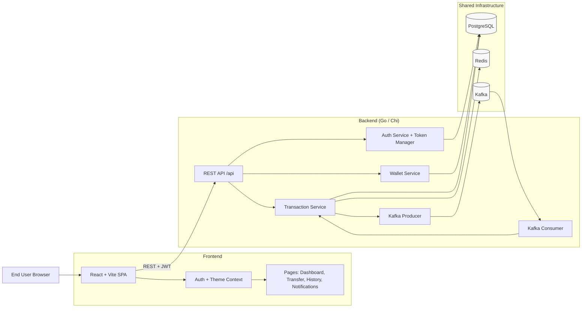

# Fluxpay High-Level Architecture

This diagram summarizes the project at a system level, focused on the React frontend, Go backend, and shared infrastructure.

## System Diagram

## Component View

- Frontend ([Frontend/src](Frontend/src)) is a React SPA using Router and Auth context.
- Go backend ([fluxpay-go/cmd/server/main.go](fluxpay-go/cmd/server/main.go)) provides the API implementation with Chi router, service/repository layers, JWT authentication, and Kafka integration.
- Shared state and messaging are handled by PostgreSQL, Redis, and Kafka from [fluxpay-go/docker-compose.yml](fluxpay-go/docker-compose.yml).

## Request/Event Flow (Go Path)

1. User logs in from React and receives a JWT token.
2. React sends authenticated REST calls to Go `/api/*`.
3. Transaction/account operations hit PostgreSQL and Redis.
4. Transaction events are published to Kafka topics.
5. Kafka consumer processes events for downstream analytics and processing.
